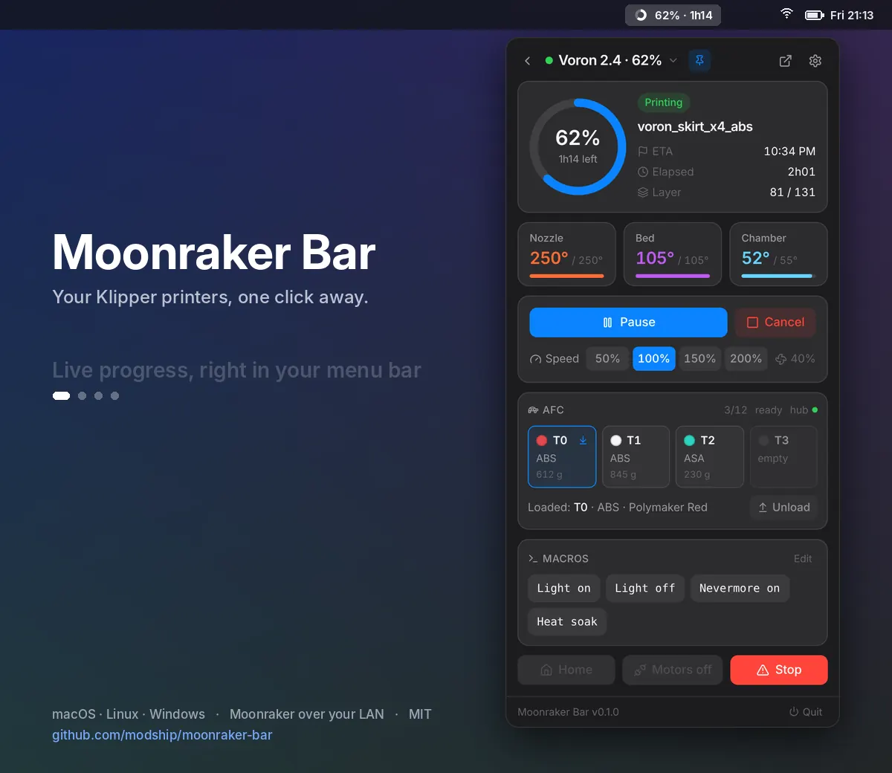
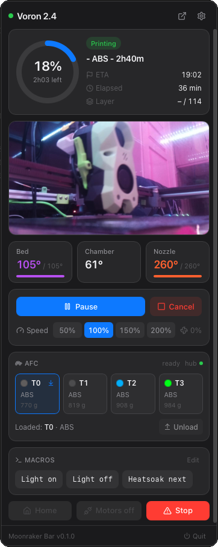
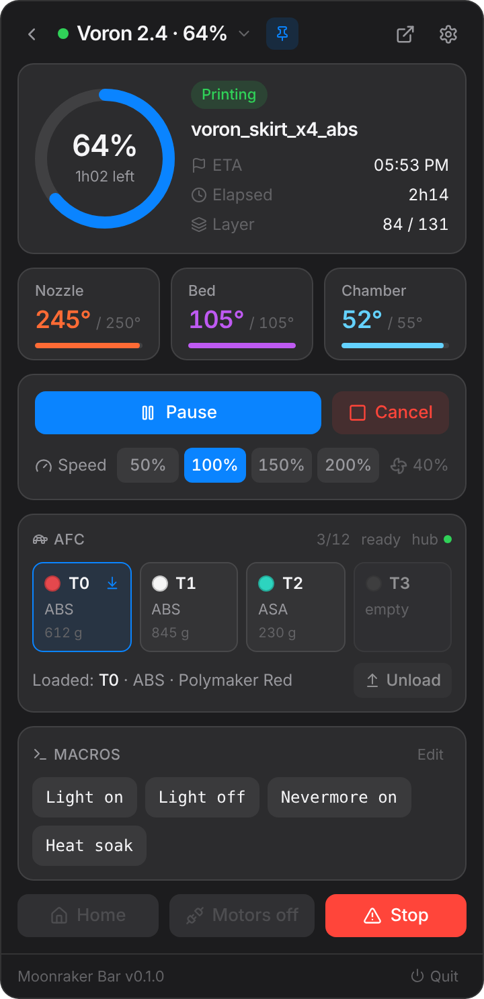
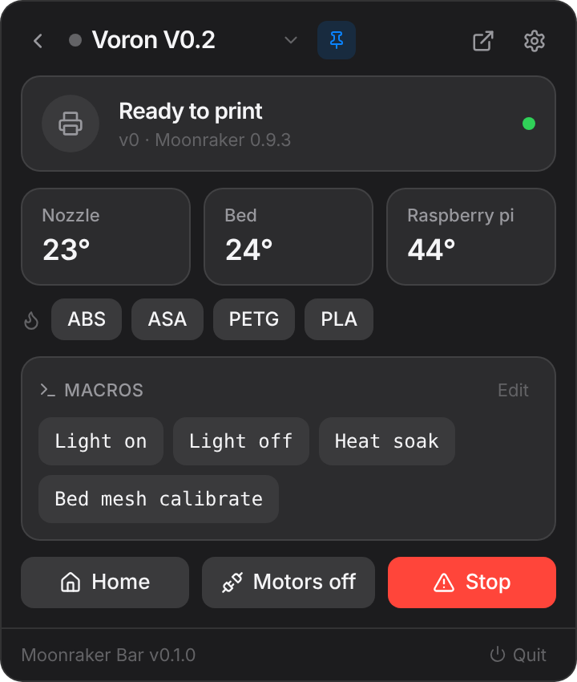
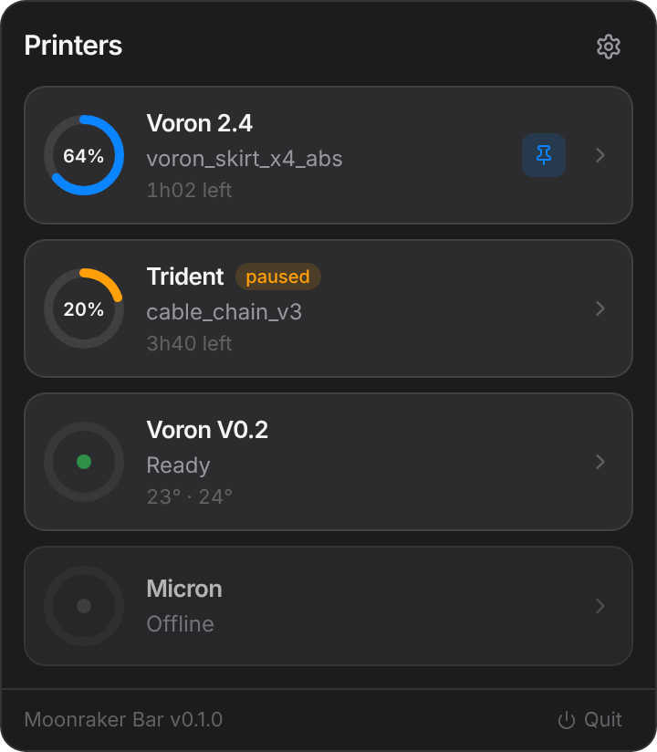
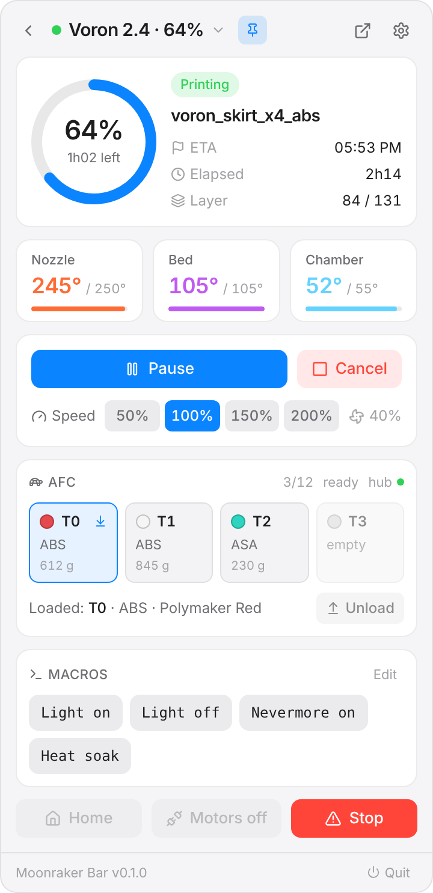
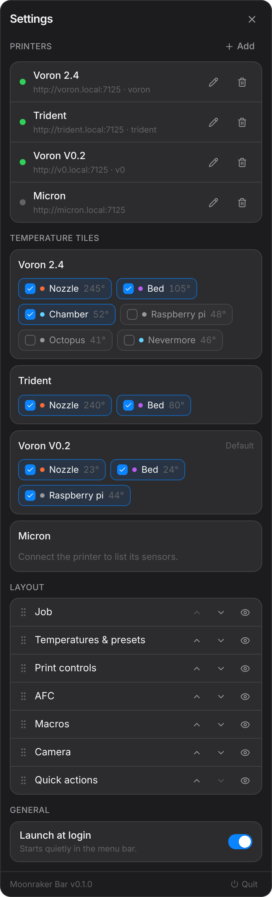

<h1 align="center">Moonraker Bar</h1>

<p align="center">
  Your Klipper printers, one click away in the menu bar.<br>
  macOS menu bar · Linux and Windows system tray · Moonraker over your LAN, no cloud.
</p>

<p align="center">
  <a href="https://github.com/modship/moonraker-bar/releases/latest"></a>
  
  
</p>

<p align="center">
  
</p>

Moonraker Bar keeps your Klipper printers in the menu bar (macOS) or system tray (Linux, Windows). Glance at the icon for progress and time left; click it for the full picture: current job, ETA, layers, temperatures, pause / resume / cancel, print speed, your pinned Klipper macros, Mainsail / Fluidd preheat presets, and every AFC lane if a Box Turtle is attached. It watches several printers at once, pins the one you care about to the bar, and notifies you when a print finishes, pauses or fails. It talks to Moonraker directly over your network: no account, no cloud, no telemetry.

Built with **Tauri 2** (Rust) and **React + TypeScript + Tailwind**.

## Screenshots

<table>
  <tr>
    <td align="center" rowspan="2" valign="top"><br><sub>A real print on a Voron 2.4: webcam, AFC, macros</sub></td>
    <td align="center"><br><sub>Printing, with AFC lanes</sub></td>
    <td align="center"><br><sub>Idle, with preheat presets</sub></td>
  </tr>
  <tr>
    <td align="center"><br><sub>Fleet view</sub></td>
    <td align="center"><br><sub>Follows the system light / dark theme</sub></td>
  </tr>
  <tr>
    <td align="center" colspan="3"><br><sub>Settings: printers, temperature tiles, layout</sub></td>
  </tr>
</table>

## Features

- **Live menu bar icon**: a ring that fills with progress, pause bars while paused, a dot when Klipper is in error. On macOS it is a template image that follows the menu bar theme, with progress and time left as text beside it (`64% · 1h02`).
- **Popover** anchored under the icon, sized to its content, closed on blur or Escape.
- **Job**: a drawing of your printer with the part growing on the bed in the filament color (a 2.4 raises its gantry, a Trident or V0 lowers its bed), the slicer thumbnail, progress, time left, ETA, elapsed time, layers.
- **Temperatures**: every heater, sensor and temperature fan Klipper reports. You choose which tiles to show, per printer.
- **Preheat presets** read from Mainsail and Fluidd, applied exactly as Mainsail does, plus a Cool down button.
- **Print controls**: pause / resume, cancel (two-step), speed 50–200 %, part fan readout.
- **Quick actions**: Home (`G28`), Motors off (`M84`), emergency stop (two-step, always available), firmware restart when Klipper is shut down.
- **Macros**: every public `gcode_macro` with its description. Pin the ones you want as buttons.
- **AFC** (Armored Turtle) detected automatically: lanes with T-number, filament color, material and remaining weight, the lane in the tool, hub state, tool-change counter, load a lane, unload, `AFC_RESUME` on error.
- **Live camera**: the webcam configured in Mainsail / Fluidd is picked up automatically and played as a live MJPEG stream (snapshot fallback every 2 s);
- **Several printers**: fleet view (printers that need attention first), switcher, and a pin to choose which printer the menu bar follows (by default, whichever is printing).
- **Find printers on your network**: Moonraker instances are discovered automatically (mDNS, plus a scan of the local network on port 7125), added in one click.
- **Notifications** when a print starts, pauses, finishes, is cancelled or fails.
- **Open in Mainsail / Fluidd** from the header.
- **Layout**: reorder and hide the panel's cards.
- **Launch at login** and **automatic updates**.

## Install

Download the file for your system from the [latest release](https://github.com/modship/moonraker-bar/releases/latest):

| System | File | Notes |
| --- | --- | --- |
| macOS (Apple Silicon and Intel) | `…_universal.dmg` | Open it and drag the app to Applications. |
| Windows | `…_x64-setup.exe` or `…_x64_en-US.msi` | SmartScreen may warn on first launch: *More info → Run anyway*. |
| Linux | `…_amd64.AppImage` | `chmod +x` then run. This is the only Linux build that updates itself. |
| Debian / Ubuntu | `…_amd64.deb` | `sudo apt install ./<file>.deb`. Updated through new `.deb` files, not in-app. |

**macOS, first launch.** Builds are not yet signed with an Apple Developer ID, so macOS blocks the app the first time with *"Moonraker Bar" Not Opened*. Click **Done** (not *Move to Trash*), then either:

- run once in Terminal:

  ```bash
  xattr -dr com.apple.quarantine "/Applications/Moonraker Bar.app"
  ```

- or open **System Settings → Privacy & Security**, scroll down to *"Moonraker Bar" was blocked* and click **Open Anyway**.

This is needed once per install; updates installed from the app are not blocked.

### Updates

Moonraker Bar checks for a new version at launch and every 6 hours. When one is available, the popover footer shows **Update x.y.z**; click it to download, install and relaunch. Updates are signed: the app only installs a package signed with the project's key.

## First run

Click the icon: Moonraker Bar looks for printers on your network and lists them; click **Add** next to yours. To add one by hand, use **Add**:

- **Name**: anything, e.g. `Voron 2.4`.
- **Moonraker URL**: `http://voron.local:7125` (or the Mainsail / Fluidd URL if Moonraker sits behind nginx).
- **API key**: only if your machine is not in `trusted_clients` in `moonraker.conf`. Create one in Mainsail or Fluidd.
- **Web UI**: optional; defaults to the Moonraker host on port 80.
- **Model**: the printer drawn in the panel; detected from the name and the Klipper config (gantry levelling, bed size), override it if the guess is wrong. Drawings exist for the Voron 2.4, Trident, V0, Snapmaker U1 (with its four docked toolheads in their filament colors), bed slingers and a generic CoreXY.
- **Camera URL**: optional. The webcam set up in Mainsail / Fluidd is used automatically; enter a stream or snapshot URL here only to override it.

**Test** checks the connection before saving. Presets are created in Mainsail or Fluidd and read when the printer connects. No `cors_domains` change is needed: the connection is a websocket from the app's Rust backend, not from a web page.

Settings are stored in the OS app-data folder (macOS: `~/Library/Application Support/dev.modship.moonraker-bar/settings.json`).

## Development

Requirements: **Rust** stable, **Node 20+**; on macOS the Xcode Command Line Tools; on Linux the [Tauri prerequisites](https://v2.tauri.app/start/prerequisites/) (`libwebkit2gtk-4.1-dev`, `libappindicator3-dev`, `librsvg2-dev`, `patchelf`).

```bash
npm install
npm run tauri dev     # run with hot reload (update checks are disabled in dev)
npm run icons         # regenerate src-tauri/icons/* from app-icon.svg
```

### Architecture

- **`src-tauri/src/moonraker/client.rs`**: one websocket JSON-RPC client per printer. It lists the printer objects, subscribes to `webhooks`, `print_stats`, `display_status`, `virtual_sdcard`, `gcode_move`, `fan`, every temperature object and the AFC objects when present, and merges each delta into a `Snapshot`. Time left comes from the file's `estimated_time`, or is extrapolated from progress. Commands run in their own task (G-code waits up to 15 min, since Klipper only answers once a script has finished). Reconnects with backoff (2 → 15 s), keepalive every 20 s.
- **`manager.rs`**: printer list, layout and preferences (persisted with `tauri-plugin-store`), fan-out of updates to the UI, notifications, choice of the printer the tray follows.
- **`tray.rs`**: renders the icon as RGBA on every change; the popover is an undecorated window placed under the icon and hidden on blur.
- **`src/`**: the React UI. It only displays state and sends commands: `store.ts` (zustand), `components/PrinterPanel.tsx`, `Afc.tsx`, `Fleet.tsx`, `Settings.tsx`.

## Roadmap

- [ ] Signed and notarized macOS builds
- [ ] Spoolman: active spool, remaining filament
- [ ] G-code file browser: start a print from recent files
- [ ] Print history
- [ ] Desktop widgets / Notification Center on macOS (needs a native extension)

## License

MIT
